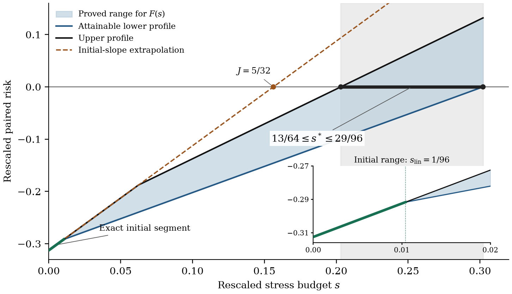

# Critical Dependence Stress

**How much dependence stress does it take to overturn a diversification gain?**

[Read the paper](paper/paper.pdf) · [Research story](docs/research-story.md) · [Results](docs/results.md) · [Reproduce](computation/README.md)


A reallocation that lowers Expected Shortfall under a reference model may stop doing so once the dependence between positions is stressed. This paper measures the smallest change in dependence that reverses the improvement, with every marginal loss distribution held fixed and both allocations assessed under the same stressed law.

Research by **[Letao Ouyang](https://130u.github.io/)** · Author manuscript, October 2026

## Three results to start with

| Result | Why it matters | Evidence |
|---|---|---|
| **At least 30% above the tangent prediction** | In the uniform benchmark the initial stress slope is attained, and it still understates the critical budget. | Corollary 5.2; [analytical bounds](docs/results.md) |
| **A common quadratic reversal law** | A tie and a strict reversal have the same leading budget, $\rho^\pm_\varepsilon=s^*\varepsilon^2+o(\varepsilon^2)$. | Theorem 3.3; [paper](paper/paper.pdf) |
| **86.67% → 88.34% background share** | With all marginals unchanged, a change in dependence raises the minimum background share and lowers its absolute displacement moment. | Proposition 5.3; [exact comparison](docs/results.md#the-same-marginals-a-different-allocation-of-stress) |

The 30% bound is for independent uniform losses on $[0,2]^3$, median ES, equal exposures and transport weights $(1,1,2)$. The background-share comparison uses the paper's explicit dependence family at equal effective costs.

## The result behind the headline



The tangent predicts reversal at **0.15625**. The proved critical coefficient lies in **[0.203125, 0.302083…]**. The lower envelope comes from explicit feasible stresses and the upper one from projection-potential bounds, and the two agree on the exact initial linear segment $0\le s\le 1/96$. The accompanying code regenerates every curve.

## The mathematical idea

Take a small transfer from holdings $(1+\varepsilon,1-\varepsilon)$ to $(1,1)$, next to a background book that does not change. Symmetry of the reference law cancels the first-order change in risk, so the diversification gain is of order $\varepsilon^2$.

The adverse stress works near the tail boundary, where it moves $O(\varepsilon)$ of mass over distances of order $\varepsilon$. Its cost and its effect on risk are then both of order $\varepsilon^2$, which puts the critical budget at $\rho=s\varepsilon^2$. These local moves disturb the marginals, and restoring them takes compensating moves elsewhere in the joint distribution. The limiting energy therefore charges for the local displacement and for the marginal restoration.

The paper turns this into a variational limit with a unique critical coefficient and shows exactly when the restoration premium vanishes. On the boundary between the two cost regimes, continuous maximum-flow/minimum-cut duality gives the share of efficient stress that the background coordinate has to absorb.

For reverse stress testing, what comes out is a distance to decision reversal and an account of where the budget goes.

## How the project took shape

I came to this problem from model-free pricing and optimal transport, and the question narrowed as I read: how robust is one particular portfolio improvement? Reading in risk aggregation, local Wasserstein sensitivity and reverse stress testing led me to the paired ES formulation. Tail-layer scaling gave the limit problem, the projection constraints explained the premium, and explicit flows and potentials put numbers on it.

- [Research story](docs/research-story.md): how the problem was chosen, the intuition behind the scaling, and the six stages of the work.
- [Literature map](docs/literature-map.md): the primary sources and the question that connects them.
- [Results](docs/results.md): the theorems, the exact constants and what they mean financially.

## Reproduce the figures and calculations

```bash
git clone https://github.com/130U/Critical-Dependence-Stress.git
cd Critical-Dependence-Stress
git checkout V_20261101
cd computation
python -m pip install -r requirements.txt
python code/run_all.py
```

The companion needs only analytical formulas and synthetic grids. It regenerates 4 figures, evaluates 1,204 profile points and checks the rational and symbolic identities exactly. The recorded run passed **60/60 scientific comparisons** and reproduced **4/4 reference PNGs** exactly. [Run record](computation/audit/RUN_ALL.json) · [Comparison record](computation/audit/OUTPUT_READBACK.json)

The [numerical profile study](computation/NUMERICAL-STUDY.md) adds finite-epsilon optimizations, with separate checks of solver, mesh, threshold and truncation effects.

For a quick check that uses only Python's standard library:

```bash
python new-computations/check_simple_example.py
```

## Paper and citation

**Critical Dependence Stress for Diversification Gains under Fixed Marginals** — Letao Ouyang, 2026.

[Public reading edition (PDF)](paper/paper.pdf) · [LaTeX source](paper/source/) · [BibTeX](paper/citation.bib)

The reading edition has the full argument with proofs, figures and bibliography, set as an article with a linked table of contents.
