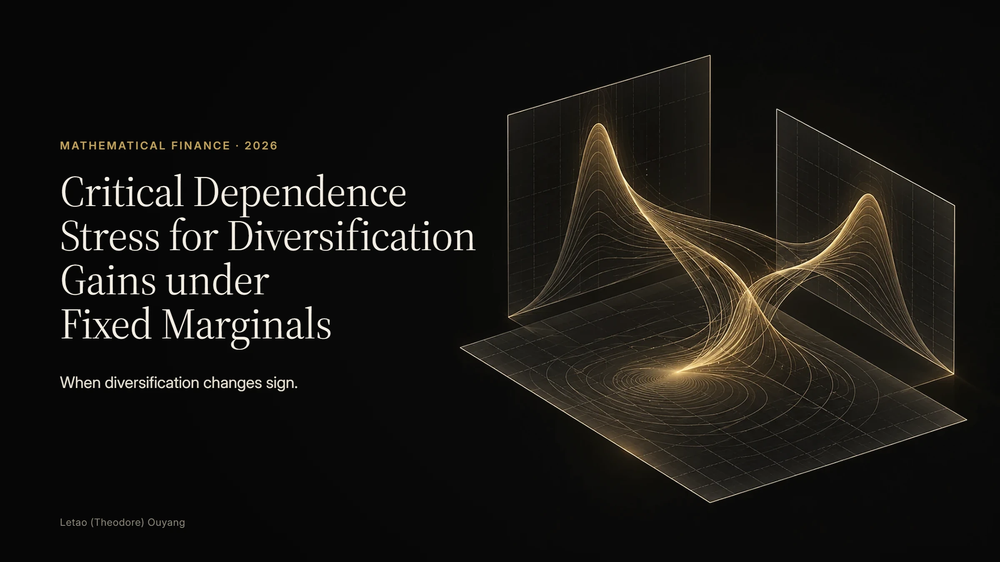
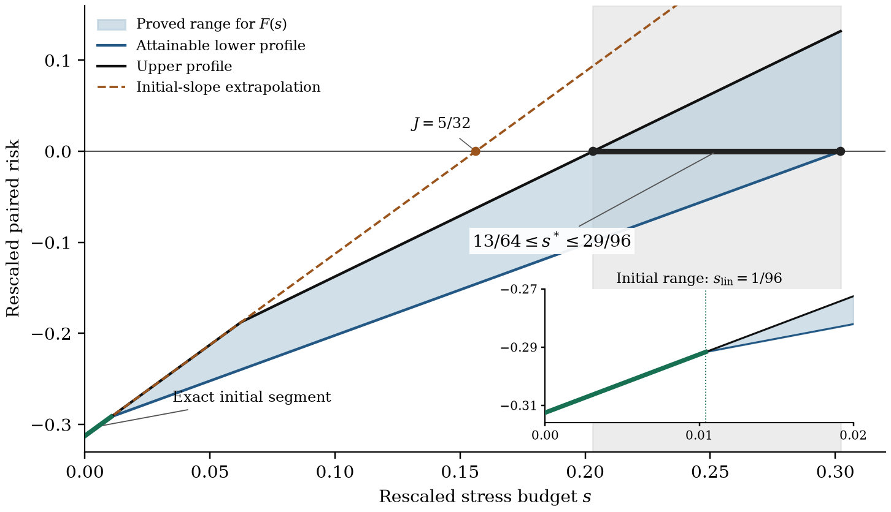

# Critical Dependence Stress for Diversification Gains under Fixed Marginals

**Letao (Theodore) Ouyang** · Independent research · November 2026

[Paper](https://www.theodoreoy.com/critical-dependence-stress-for-diversification-gains-under-fixed-marginals/) · [PDF](paper/paper.pdf) · [Research story](docs/research-story.md) · [Results](docs/results.md) · [Computation](computation/README.md)

**How much dependence stress does it take to overturn a diversification gain?**

A reallocation that lowers Expected Shortfall under a reference model can stop doing so once the dependence between positions is stressed. I measure the smallest change in dependence that reverses the improvement, with every marginal loss distribution held fixed and both allocations assessed under the same stressed law, and prove that it is quadratic in the trade size, with a leading coefficient identified through a variational limit and at least 30% above the tangent prediction in a uniform benchmark.

## Three results to start with

| Result | Why it matters | Where |
| --- | --- | --- |
| **At least 30% above the tangent prediction** | In the uniform benchmark the initial stress slope is attained, and it still understates the critical budget. | Corollary 5.2; [analytical bounds](docs/results.md) |
| **A common quadratic reversal law** | A tie and a strict reversal have the same leading budget, $`\rho^\pm_\varepsilon=s^*\varepsilon^2+o(\varepsilon^2)`$. | Theorem 3.3; [paper](paper/paper.pdf) |
| **86.67% → 88.34% background share** | With all marginals unchanged, a change in dependence raises the minimum background share and lowers its absolute displacement moment. | Proposition 5.3; [exact comparison](docs/results.md#the-same-marginals-a-different-allocation-of-stress) |

The 30% bound is for independent uniform losses on $`[0,2]^3`$, median ES, equal exposures and transport weights $`(1,1,2)`$. The background-share comparison uses the paper's explicit dependence family at equal effective costs.

## The result behind the headline

The tangent predicts reversal at **0.15625**. The proved critical coefficient lies in **[0.203125, 0.302083…]**. The lower envelope comes from explicit feasible stresses and the upper one from projection-potential bounds, and the two agree on the exact initial linear segment $`0\le s\le 1/96`$. The accompanying code regenerates every curve.

## The mathematical idea

Take a small transfer from holdings $`(1+\varepsilon,1-\varepsilon)`$ to $`(1,1)`$, next to a background book that does not change. Symmetry of the reference law cancels the first-order change in risk, so the diversification gain is of order $`\varepsilon^2`$.

The adverse stress works near the tail boundary, where it moves $`O(\varepsilon)`$ of mass over distances of order $`\varepsilon`$. Its cost and its effect on risk are then both of order $`\varepsilon^2`$, which puts the critical budget at $`\rho=s\varepsilon^2`$. These local moves disturb the marginals, and restoring them takes compensating moves elsewhere in the joint distribution. The limiting energy therefore charges for the local displacement and for the marginal restoration.

The paper turns this into a variational limit with a unique critical coefficient and shows exactly when the restoration premium vanishes. On the boundary between the two cost regimes, continuous maximum-flow/minimum-cut duality gives the share of efficient stress that the background coordinate has to absorb.

For reverse stress testing, the result is a distance to decision reversal and an account of where the budget goes.

## How the argument was built

I came to this problem from model-free pricing and optimal transport, and I sharpened it to one question: how robust is a given portfolio improvement? Reading in risk aggregation, local Wasserstein sensitivity and reverse stress testing led me to the paired ES formulation. Tail-layer scaling gave the limit problem, the projection constraints explained the premium, and explicit flows and potentials put numbers on it.

- [Research story](docs/research-story.md): how the problem was chosen, the intuition behind the scaling, and the six stages of the work.
- [Literature map](docs/literature-map.md): the primary sources and the question that connects them.
- [Results](docs/results.md): the theorems, the exact constants and what they mean financially.

## Computed evidence

The [computational companion](computation/README.md) recomputes the paper's four figures and the constants above from analytical formulas and synthetic grids, with 1,204 profile points and exact rational and symbolic checks of the identities. The recorded run passed **60/60 scientific comparisons** and reproduced **4/4 reference PNGs** exactly. [Run record](computation/audit/RUN_ALL.json) · [Comparison record](computation/audit/OUTPUT_READBACK.json)

The [numerical profile study](computation/NUMERICAL-STUDY.md) adds finite-epsilon optimizations, with separate checks of solver, mesh, threshold and truncation effects.

## Repository

| Path | Contents |
| --- | --- |
| [`paper/paper.pdf`](paper/paper.pdf) | The paper: the full argument with proofs, figures and bibliography, with a linked table of contents |
| [`paper/source/`](paper/source/) | Its LaTeX source and build script |
| [`paper/citation.bib`](paper/citation.bib) | The BibTeX entry |
| [`docs/`](docs/research-story.md) | The research story, the literature map and the results |
| [`computation/`](computation/README.md) | The computational companion: code, exact calculations, the four figures and their run records |
| [`computation/NUMERICAL-STUDY.md`](computation/NUMERICAL-STUDY.md) | The numerical profile study |

## Citation

Letao (Theodore) Ouyang, *Critical Dependence Stress for Diversification Gains under Fixed Marginals* (2026), <https://www.theodoreoy.com/critical-dependence-stress-for-diversification-gains-under-fixed-marginals/>. See [CITATION.cff](CITATION.cff).

[theodore.oy2025@gmail.com](mailto:theodore.oy2025@gmail.com) · [10@alumni.duke.edu](mailto:10@alumni.duke.edu)

© Letao (Theodore) Ouyang. All rights reserved.
