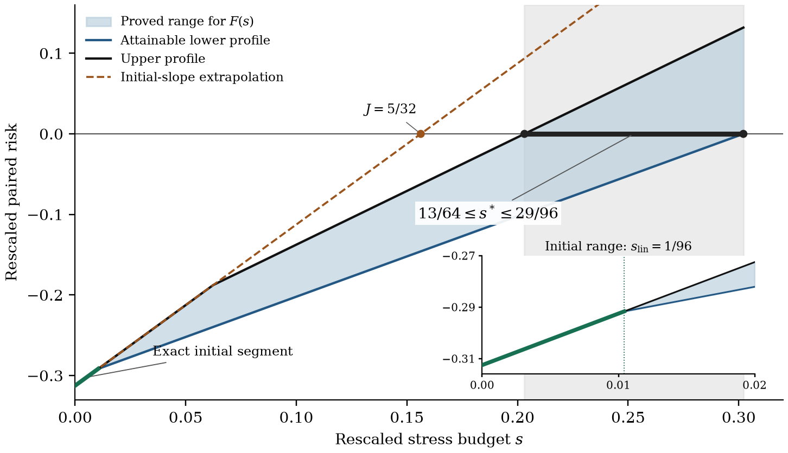

# Results and mathematical contributions

The paper determines how much dependence stress it takes to erase a diversification gain when every marginal loss distribution is preserved. The central result is a critical-budget law, and with it a geometric explanation of the extra cost that marginal conservation imposes.

## A reversal budget at least 30% above the tangent prediction

For independent uniform losses on $[0,2]$, median expected shortfall, equal portfolio exposures, and transport weights $(\gamma_0,\gamma_0,2\gamma_0)$, the paper proves

$$
\frac{13}{64}\leq \frac{s^*}{\gamma_0}\leq\frac{29}{96},
\qquad
\frac{s^*}{\gamma_0J}\geq 1.30,
\qquad J=\frac{5}{32}.
$$

The tangent prediction is $0.15625\gamma_0$, and the proved critical interval is $[0.203125,\,0.302083\ldots]\gamma_0$. An initial sensitivity that is attained exactly can still understate the reversal budget by **at least 30%**. The statement is analytical and holds for the specified model.

The shaded region brackets the critical profile. Explicit kernels attain its lower boundary, and projection potentials give its upper boundary. The two coincide on the exact initial segment

$$
F(s)=2s-\frac{5}{16},\qquad 0\leq s\leq\frac{1}{96}
$$

when $\gamma_0=1$. The figure plots these proved envelopes; see Corollary 5.2 and Section 5.1 of the [paper](../paper/paper.pdf).

## The same marginals, a different allocation of stress

The family

$$
f_\vartheta(x,y,z)=\frac{1+\vartheta(x+y-2)(z-1)}8,
\qquad |\vartheta|<\frac12,
$$

keeps all three marginals uniform. At equal effective transport costs, its optimal boundary flows give the following exact comparison:

| Quantity | Independence: $\vartheta=0$ | Positive dependence: $\vartheta=1/4$ |
|---|---:|---:|
| Tail-surface moment $J_\vartheta$ | $5/32$ | $143/960$ |
| Minimum background share $a_{+,\vartheta}$ | $13/15$ = **86.67%** | $379/429$ = **88.34%** |
| Background displacement moment $J_\vartheta a_{+,\vartheta}$ | $13/96$ = **0.13542** | $379/2880$ = **0.13160** |

The background share goes up while its absolute displacement moment goes down, and this holds across the whole parameter interval:

$$
\frac{d a_{+,\vartheta}}{d\vartheta}
=\frac{360}{(75-14\vartheta)^2}>0,
\qquad
\frac{d(J_\vartheta a_{+,\vartheta})}{d\vartheta}
=-\frac{11}{720}.
$$

The reason shows on the tail surface, where a change in dependence changes the capacity available for balancing traded-coordinate flows. Proposition 5.3 gives a feasible flow and a dual value that matches it.

## Theorems behind the numbers

| Result | What it establishes | Paper |
|---|---|---|
| Variational limit with exact marginal recovery | The effective energy combines local displacement with the cost of restoring all three marginal laws. | Theorem 3.1 |
| A common critical coefficient | Tie and strict reversal both satisfy $\rho^\pm_\varepsilon=s^*\varepsilon^2+o(\varepsilon^2)$, with $s^*$ the unique zero of a strictly increasing profile. | Theorem 3.3 |
| Complete zero-premium classification in the exchangeable box model | $s^*=Jc_{\min}$ exactly when the background effective cost is no greater than either traded-coordinate cost. | Theorem 4.2 |
| Boundary sensitivity through projected flow duality | The first-order coefficient of the normalized premium equals the minimum background share in an optimal flow. | Theorem 4.3 |

Taken together, these results turn a local sensitivity calculation into a criterion for when the portfolio ranking changes. The mathematical contribution is the link between the geometry of the tail layer, exact marginal compensation and the reversal threshold.

## Reproduce the illustrations

The [computational companion](../computation/README.md) regenerates all four manuscript figures, checks the polynomial identities symbolically and the rational constants exactly, and compares the generated arrays and profile table with the frozen reference. Its execution record keeps these computational checks apart from the analytical proofs in the paper.
